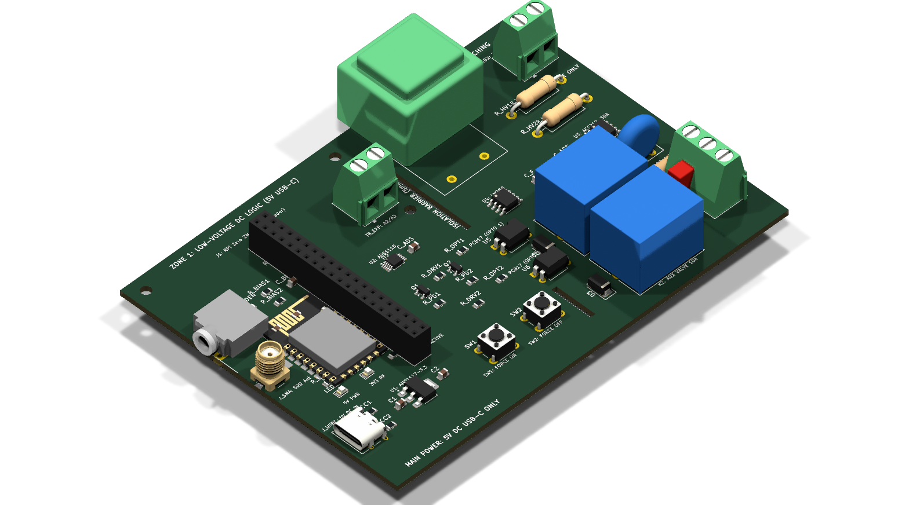
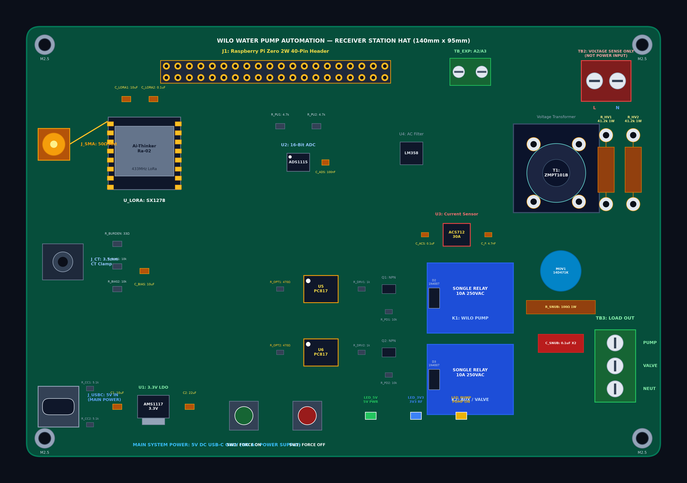

# Wilo Water Pump Automation — Receiver Station PCB

[](https://kicad.org)
[-success.svg)](#hardware-specifications)
[](#electrical-safety--dual-zone-architecture)
[](#electrical-safety--dual-zone-architecture)
[](LICENSE)

Production-ready, dual-zone hardware design and KiCad project for the **Wilo Water Pump Automation Receiver Station HAT**. This board hosts the Raspberry Pi Zero 2W, Ai-Thinker Ra-02 (SX1278) LoRa radio transceiver, Texas Instruments ADS1115 16-bit ADC, Allegro ACS712 30A Hall-effect current sensor, ZMPT101B potential transformer, and dual 10A power relays with comprehensive EMI snubber and MOV surge suppression.

---

## Visual Gallery

<p align="center">
  
  <br/>
  <em>Figure 1: Photorealistic 3D raytrace of the Wilo Receiver HAT showing the 5 mm physical isolation slots, optocoupler barrier, power relays, and RF section.</em>
</p>

<p align="center">
  
  <br/>
  <em>Figure 2: Composite 2D PCB layout showing strictly partitioned Zone 1 (Low-Voltage DC Logic) and Zone 2 (230V AC Mains & Power Switching).</em>
</p>

---

## Key Hardware Features

- **Standard Raspberry Pi Zero 2W HAT**: 120 mm × 85 mm footprint with standard M2.5 mounting holes aligned to Raspberry Pi Zero mounting standoffs.
- **5V DC Main Power via USB Type-C**: Dedicated USB-C receptacle with dual 5.1 kΩ CC pull-down resistors (`R_CC1`, `R_CC2`) for universal USB-PD / Type-C power supply negotiation.
- **Dedicated 3.3V Low-Noise Power Rail**: Onboard AMS1117-3.3 LDO regulator with 10 µF input (`C1`) and 22 µF output (`C2`) capacitors isolates the SX1278 RF module and sensor conditioning circuits from Raspberry Pi onboard rail noise.
- **Ai-Thinker Ra-02 LoRa Transceiver (SPI0)**: 433 MHz SX1278 transceiver with dedicated 10 µF electrolytic + 100 nF ceramic transient decoupling and 50 Ω edge-launch SMA antenna connector.
- **ADS1115 16-Bit Precision ADC (I2C1)**: Dedicated analog front-end for motor current monitoring, mains voltage sampling, and two auxiliary analog expansion channels (`A2`, `A3`).
- **Dual Motor Current Sensing Options**:
  - Direct Allegro ACS712T-30A Hall-effect sensor with RC low-pass filter and 100 nF decoupling.
  - Optional SCT-013-000 3.5 mm CT clamp audio jack with 33 Ω burden resistor and 1.65 V DC bias divider network.
- **ZMPT101B High-Precision AC Voltage Transformer**: 1000:1000 micro potential transformer driven by dual 41.2 kΩ 1W metal film resistors and an onboard LM358 signal conditioning amplifier.
- **Optically Isolated Dual 10A Relays**:
  - **Relay K1 (Primary Wilo Pump)**: Driven via PC817 optocoupler and MMBT3904 NPN transistor, protected by 1N4007 flyback diode, 14D471K MOV, and RC snubber (100 Ω 1W + 0.1 µF 630V X2 film cap).
  - **Relay K2 (Auxiliary Valve / Contactor)**: Driven via PC817 optocoupler and MMBT3904 NPN transistor with 1N4007 flyback diode.
- **Manual Hardware Overrides**: Tactile push buttons for **Force ON** (`SW1` → GPIO22) and **Force OFF** (`SW2` → GPIO5), plus visual status LEDs (`LED_5V`, `LED_3V3`, `LED_PUMP`).

---

## Hardware Specifications

| Parameter | Specification | Notes |
|---|---|---|
| **Board Dimensions** | 120.0 mm × 85.0 mm | Standard rectangular 2-layer FR4 |
| **Board Thickness** | 1.6 mm | Standard industrial PCB thickness |
| **Copper Weight** | 2.0 oz (70 µm) outer layers | **Recommended** to support 10A pump motor loads |
| **Logic Voltage** | 3.3 V DC | All Raspberry Pi GPIOs are strictly 3.3V |
| **Main Power Input** | 5.0 V DC via USB Type-C (`J_USBC`) | Powers Pi, Relays, ACS712, and AMS1117 |
| **Mains Voltage Range** | 80 V – 260 V AC (50/60 Hz) | Sampled via ZMPT101B potential transformer |
| **Motor Current Range** | 0 – 30 A AC (RMS) | Scaled for pumps up to 5.5 kW (FLA ~11.4A) |
| **Relay Contact Rating** | 10 A @ 250 V AC / 10 A @ 30 V DC | Songle SRD-05VDC-SL-C Form C |
| **Isolation Barrier** | 5.0 mm Milled Non-Plated Slots (`Edge.Cuts`) | IEC 60950-1 / IEC 61010-1 creepage compliance |
| **RF Operating Band** | 433 MHz (Ra-02 / SX1278) | 50 Ω SMA edge connector |

---

## Electrical Safety & Dual-Zone Architecture

To prevent dangerous 230V AC mains transients from reaching sensitive microcontroller logic, the PCB enforces strict physical and electrical segregation into two distinct zones:

```
┌──────────────────────────────────────────────────┬───┬─────────────────────────────────────────────────┐
│ ZONE 1: LOW-VOLTAGE DC LOGIC                     │ I │ ZONE 2: 230V AC MAINS & POWER SWITCHING         │
│                                                  │ S │                                                 │
│ • Raspberry Pi Zero 2W 40-Pin Header (J1)        │ O │ • 2-Pin AC Mains Sense Terminal (TB2: L, N)     │
│ • USB Type-C 5V Main Power Input (J_USBC)        │ L │ • ZMPT101B Potential Transformer (T1)           │
│ • AMS1117-3.3V Low-Noise LDO Regulator (U1)      │ A │ • Dual 41.2k 1W Metal Film Limiting Resistors   │
│ • Ai-Thinker Ra-02 433MHz LoRa Module (U_LORA)   │ T │ • Allegro ACS712-30A Current Sensor (U3)        │
│ • ADS1115 16-Bit Precision I2C ADC (U2)          │ I │ • LM358 Signal Conditioner (U4)                 │
│ • SCT-013 3.5mm CT Clamp Audio Jack (J_CT)       │ O │ • Songle 10A Primary Pump Relay (K1)            │
│ • Manual Force ON / Force OFF Buttons (SW1, SW2) │ N │ • Songle 10A Auxiliary Valve Relay (K2)         │
│ • System Power & Pump Status LEDs                │   │ • 14D471K Metal Oxide Varistor (MOV1)           │
│ • PC817 Optocoupler Inputs (Low-Voltage Side)    │ S │ • RC Snubber: 100Ω 1W + 0.1µF 630V X2 (R/C_SNUB)│
│                                                  │ L │ • 3-Pin Actuator Output Terminal (TB3)          │
│ Ground: Clean Solid DC Signal Ground Plane       │ O │ Ground: High-Voltage Neutral / Return Track     │
│ Creepage: ≥ 5.0 mm Clearance                     │ T │ Creepage: Physical Isolation Milled Slots       │
└──────────────────────────────────────────────────┴───┴─────────────────────────────────────────────────┘
```

> [!IMPORTANT]
> Never connect 230V AC mains directly to the Zone 1 DC section. Optical isolation (PC817) and physical milled slots provide galvanic isolation between the Raspberry Pi and high-voltage contactors.

---

## Pinout & Interconnect Mapping

### 1. Raspberry Pi Zero 2W 40-Pin Header (`J1`)

| Physical Pin | BCM / GPIO | Signal Function | Target Destination on PCB |
|---|---|---|---|
| **Pin 1** | — | **+3.3V DC Power** | System 3.3V reference rail |
| **Pin 2, 4** | — | **+5.0V DC Power** | 5V rail (fed directly from USB-C `J_USBC`) |
| **Pin 6, 9, 14, 20** | — | **GND** | System ground plane |
| **Pin 3** | GPIO2 | **I2C1_SDA** | ADS1115 ADC `SDA` (with 4.7 kΩ pull-up `R_PU1`) |
| **Pin 5** | GPIO3 | **I2C1_SCL** | ADS1115 ADC `SCL` (with 4.7 kΩ pull-up `R_PU2`) |
| **Pin 11** | GPIO17 | **PUMP_RELAY_CTRL** | Primary Pump Relay driver (`Q1` base / `U5` opto) |
| **Pin 13** | GPIO27 | **VALVE_RELAY_CTRL** | Auxiliary Valve Relay driver (`Q2` base / `U6` opto) |
| **Pin 15** | GPIO22 | **SW_FORCE_ON** | Manual Force ON tactile push button (`SW1` to GND) |
| **Pin 18** | GPIO24 | **LORA_DIO0** | SX1278 Packet Rx/Tx Interrupt pin |
| **Pin 19** | GPIO10 | **SPI0_MOSI** | SX1278 LoRa `MOSI` pin |
| **Pin 21** | GPIO9 | **SPI0_MISO** | SX1278 LoRa `MISO` pin |
| **Pin 22** | GPIO25 | **LORA_RESET** | SX1278 LoRa hardware `RESET` pin |
| **Pin 23** | GPIO11 | **SPI0_SCLK** | SX1278 LoRa `SCK` clock pin |
| **Pin 24** | GPIO8 | **SPI0_CE0** | SX1278 LoRa Chip Select (`NSS`) pin |
| **Pin 29** | GPIO5 | **SW_FORCE_OFF** | Manual Force OFF tactile push button (`SW2` to GND) |
| **Pin 31** | GPIO6 | **LED_PUMP_IND** | Pump Active status LED driver via 330 Ω resistor |

### 2. ADS1115 16-Bit ADC Channel Assignments

| Channel | Signal Source | Input Conditioning Circuit | Target Metric |
|---|---|---|---|
| **Channel A0** | Motor Current Sensor | ACS712T-30A (0.5–4.5V) or SCT-013-000 with 1.65V DC Bias | Active pump motor current (RMS amperes) |
| **Channel A1** | Mains AC Voltage | ZMPT101B potential transformer via LM358 op-amp | True-RMS AC mains line voltage (VAC) |
| **Channel A2** | Auxiliary Sensor 1 | 2-pin screw terminal block `TB_EXP` (Pin 1) | Flowmeter / Water level analog input |
| **Channel A3** | Auxiliary Sensor 2 | 2-pin screw terminal block `TB_EXP` (Pin 2) | Pressure transducer / Auxiliary sensor |

---

## Bill of Materials (BOM Summary)

| Designator | Value / Part Number | Description | Package / Footprint | Qty |
|---|---|---|---|---|
| **`J1`** | 2×20 2.54 mm Female Socket | Raspberry Pi Zero 2W GPIO Header | PinSocket_2x20_P2.54mm_Vertical | 1 |
| **`J_USBC`** | TYPE-C-31-M-12 | USB Type-C 16-Pin Receptacle (5V Power) | USB_C_Receptacle_HRO_TYPE-C-31-M-12 | 1 |
| **`U1`** | AMS1117-3.3 | 3.3V 1A Low-Dropout Linear Regulator | SOT-223-3_TabPin2 | 1 |
| **`U2`** | ADS1115IDGSR | 16-Bit 860SPS 4-Channel Precision I2C ADC | MSOP-10_3x3mm_P0.5mm | 1 |
| **`U3`** | ACS712ELCTR-30A-T | 30A Hall-Effect Linear Current Sensor | SOIC-8_3.9x4.9mm_P1.27mm | 1 |
| **`U4`** | LM358DR | Dual Operational Amplifier (Signal Filter) | SOIC-8_3.9x4.9mm_P1.27mm | 1 |
| **`U5`, `U6`** | PC817 | 5 kV Galvanic Isolation Optocouplers | DIP-4_W7.62mm | 2 |
| **`U_LORA`** | Ai-Thinker Ra-02 | SX1278 433 MHz LoRa Radio Transceiver | Module_Ai-Thinker-Ra-01-LoRa | 1 |
| **`T1`** | ZMPT101K | 1000:1000 Precision Voltage Transformer | Transformer_Zeming_ZMPT101K | 1 |
| **`K1`, `K2`** | SRD-05VDC-SL-C | 5V Coil 10A 250VAC SPDT Power Relays | Relay_SPDT_SANYOU_SRD_Series | 2 |
| **`MOV1`** | 14D471K | 275V AC / 470V Clamp Metal Oxide Varistor | Disc_D12mm_P7.5mm | 1 |
| **`C_SNUB1`** | 0.1 µF 630V X2 | Film Snubber Capacitor across Relay K1 | C_Rect_L10mm_W4mm_P7.5mm | 1 |
| **`R_SNUB1`** | 100 Ω 1W | Flame-proof Snubber Resistor across K1 | R_Axial_DIN0411_P15.24mm | 1 |
| **`R_HV1`, `R_HV2`**| 41.2 kΩ 1W | Precision High-Voltage Limiting Resistors | R_Axial_DIN0411_P15.24mm | 2 |
| **`D2`, `D3`** | 1N4007 | 1000V 1A Flyback Suppression Diodes | D_SMA | 2 |
| **`Q1`, `Q2`** | MMBT3904 | 40V 200mA NPN Driver Transistors | SOT-23 | 2 |
| **`SW1`, `SW2`** | 6 mm Tactile Button | Force ON (Green) & Force OFF (Red) Buttons | SW_PUSH_6mm | 2 |
| **`LED_5V`, `LED_3V3`, `LED_PUMP`** | 0805 SMD LEDs | Power & Pump Status Indicator LEDs | LED_0805_2012Metric | 3 |
| **`TB2`, `TB_EXP`** | MKDS 1,5/2-5.08 | 2-Pin 5.08 mm Screw Terminal Blocks | MKDS-1,5-2-5.08 | 2 |
| **`TB3`** | MKDS 1,5/3-5.08 | 3-Pin 5.08 mm Screw Terminal Block (Load Out) | MKDS-1,5-3-5.08 | 1 |
| **`J_SMA`** | 132134-10 | 50 Ω Female Edge SMA RF Connector | SMA_Amphenol_132134-10_Vertical | 1 |
| **`J_CT`** | SJ1-3513N | 3.5 mm Audio Jack for SCT-013 CT Clamp | Audio_Jack_3.5mm_CUI_SJ1-3513N | 1 |

*See [`bom.csv`](bom.csv) for the full line-by-line part list including ordering part numbers.*

---

## Quick Start (Opening in KiCad)

This project is built with **zero external library dependencies** using relative paths (`${KIPRJMOD}`) so it can be extracted and opened immediately on any operating system without missing footprints or symbols.

1. **Clone or Download the Repository**:
   ```bash
   git clone https://github.com/officialayush5839-arch/Wilo-Receiver-PCB.git
   cd Wilo-Receiver-PCB
   ```
2. **Open in KiCad**:
   - Launch **KiCad 7, 8, 9, or 10**.
   - Click **File → Open Project...** (`Ctrl + O`).
   - Select `wilo_receiver.kicad_pro`.
3. **Inspect the Files**:
   - Double-click **`wilo_receiver.kicad_pcb`** to inspect traces, clearance zones, and pad geometry.
   - Double-click **`wilo_receiver.kicad_sch`** to view the full schematic and netlabels.
   - Inside the PCB Editor, press **`Alt + 3`** to launch the interactive 3D raytracing viewer.

---

## Manufacturing & Gerber Files

Fabrication-ready RS-274X Gerber files and Excellon NC drill files are located in the [`gerbers/`](gerbers/) folder:

| File | Layer Description |
|---|---|
| `wilo_receiver-F_Cu.gtl` | Front Copper (Top Layer) |
| `wilo_receiver-B_Cu.gbl` | Back Copper (Bottom Ground Plane) |
| `wilo_receiver-F_Mask.gts` | Top Solder Mask |
| `wilo_receiver-B_Mask.gbs` | Bottom Solder Mask |
| `wilo_receiver-F_Silkscreen.gto` | Top Silkscreen (Component Designators & Zone Labels) |
| `wilo_receiver-B_Silkscreen.gbo` | Bottom Silkscreen |
| `wilo_receiver-Edge_Cuts.gm1` | Board Outline (120 × 85 mm) & 5 mm Milled Creepage Slots |
| `wilo_receiver.drl` | Excellon NC Drill File (Plated & Non-Plated Holes) |

### Recommended PCB Fabrication Ordering Parameters:
- **Layers**: 2 Layers
- **Material**: Standard FR4 (TG130–150)
- **Board Thickness**: 1.6 mm
- **Copper Weight**: **2.0 oz (70 µm)** outer layers (essential for supporting 10A pump switching currents without thermal rise)
- **Surface Finish**: **HASL Lead-Free** or **ENIG** (Electroless Nickel Immersion Gold)
- **Solder Mask Color**: Matte Black or Dark Green
- **Silkscreen Color**: White

---

## Companion Firmware & Calibration

Pre-configured Python 3 drivers and calibration utilities are located in [`firmware/`](firmware/):

- **[`tank_config.py`](firmware/tank_config.py)**: Central configuration file containing all Raspberry Pi BCM GPIO pin assignments, ADS1115 I2C addresses, calibration constants, and safety protection thresholds:
  ```python
  # Safety Threshold Constants
  POWER_VOLTAGE_PROTECTION = True
  UNDER_VOLTAGE_THRESHOLD  = 180.0   # Trip if voltage < 180V AC for > 10s
  DRY_RUN_CURRENT_AMPS     = 1.5     # Trip if pump current < 1.5A for > 2s
  OVERLOAD_CURRENT_AMPS    = 13.7    # Trip if pump current > 1.2x FLA (> 13.7A for > 3s)
  ```
- **[`calibrate_voltage.py`](firmware/calibrate_voltage.py)**: Interactive True-RMS voltage calibration utility for scaling the ZMPT101B analog front-end against a trusted digital multimeter.
- **[`measure_current.py`](firmware/measure_current.py)**: Real-time current acquisition engine supporting both ACS712 and SCT-013 CT clamp sensors with stateful anti-bounce trip timers.

---

## Repository Structure

```
Wilo-Receiver-PCB/
├── wilo_receiver.kicad_pro      # Main KiCad Project File
├── wilo_receiver.kicad_pcb      # KiCad PCB Layout (120x85mm, 2-layer)
├── wilo_receiver.kicad_sch      # KiCad Schematic
├── wilo_receiver.kicad_sym      # Local Symbol Library
├── fp-lib-table                 # Footprint Library Table (Relative ${KIPRJMOD})
├── sym-lib-table                # Symbol Library Table (Relative ${KIPRJMOD})
├── bom.csv                      # Full Bill of Materials with Designators
├── wilo_receiver.pretty/        # 44 Project-Local Footprint Models (.kicad_mod)
├── gerbers/                     # 16 Production Gerber & Excellon Drill Files
├── firmware/                    # Python Calibration & Protection Drivers
│   ├── tank_config.py
│   ├── calibrate_voltage.py
│   └── measure_current.py
├── wilo_receiver_board_top.png  # High-Resolution 2D Layout Composite
├── wilo_receiver_2d_board.svg   # Native Vector SVG Board Layout
├── wilo_receiver_3d_iso.png     # Photorealistic 3D Isometric Raytrace
├── wilo_receiver_3d_top.png     # Photorealistic 3D Top Raytrace
└── README.md                    # Comprehensive Hardware Documentation
```

---

## License

This hardware design and all associated KiCad files, schematics, layouts, and companion software are released under the [MIT License](LICENSE).
